<a href="https://realdealcpa.ai"></a>

  
  
  
  



 

  <a href="https://github.com/RealDealCPA-VR/Iron-Jarvis"></a>
  <a href="https://github.com/RealDealCPA-VR/Raster-studio"></a>
  <a href="https://github.com/RealDealCPA-VR/IronCore"></a>
  <a href="https://github.com/RealDealCPA-VR/Quickbooks-MCP-Desktop"></a>
  <a href="https://github.com/RealDealCPA-VR/Iron-Proxy"></a>
  <a href="https://github.com/RealDealCPA-VR/KarbonCopy"></a>

  <a href="https://github.com/RealDealCPA-VR/Iron-Jarvis">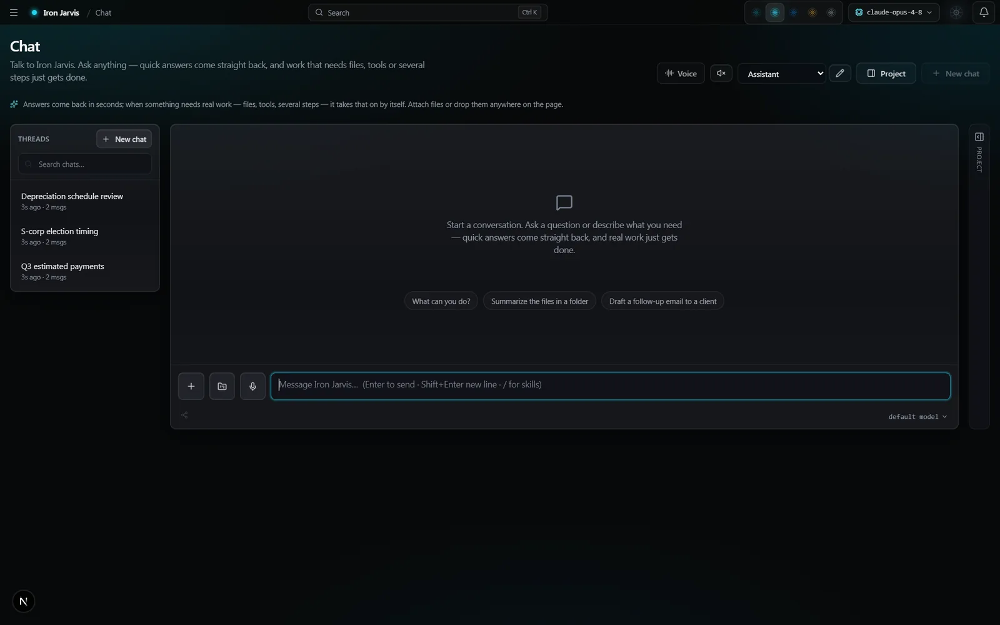</a>
  <a href="https://github.com/RealDealCPA-VR/Raster-studio">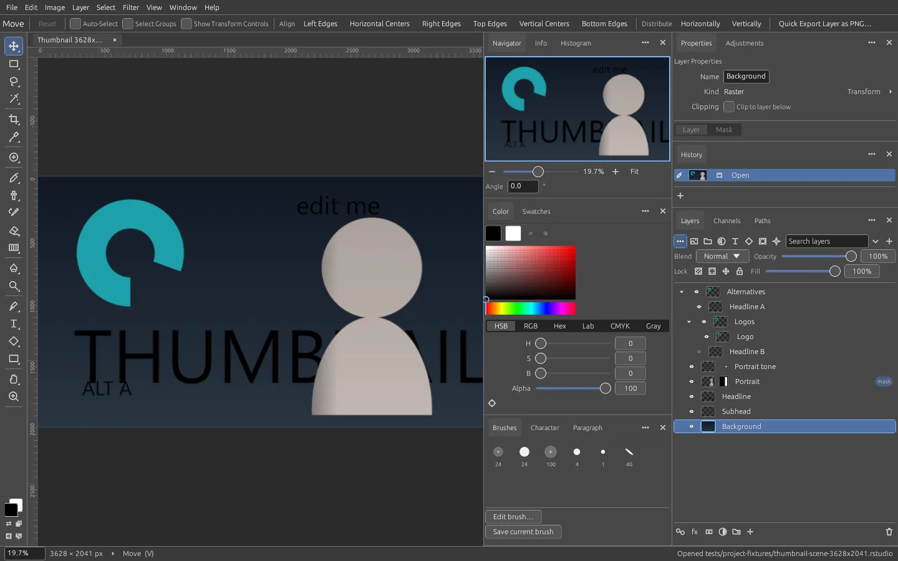</a>

  <a href="https://realdealcpa-vr.github.io/aiskilltree/">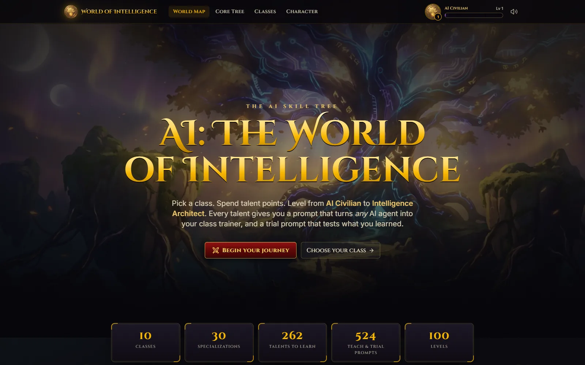</a>
   
  <b>AI: The World of Intelligence</b> · 262 talents, 10 classes, an AI examiner for every skill · <a href="https://realdealcpa-vr.github.io/aiskilltree/">play it free →</a>



| | Build | What it does |
|:-:|---|---|
| 🟡 | [**Lacerte MCP**](https://github.com/RealDealCPA-VR/LacertMCP) | Professional tax software, callable by AI. |
| 🟡 | [**BookKeeper AI**](https://github.com/RealDealCPA-VR/Open-Source-QB) | Open-source desktop accounting with AI error correction. |
| 🧪 | [**RealDeal CPA Agent**](https://github.com/RealDealCPA-VR/VR-Agent) | An AI accounting employee, not a chatbot. |
| 🟢 | [**vr-ledger**](https://github.com/RealDealCPA-VR/VR-Ledger) | Plain-text double-entry books your code can query. |
| 🟢 | [**ExcelLocal**](https://github.com/RealDealCPA-VR/Execllocal) | A local AI agent inside Excel. |
| 🟢 | [**BookwriterPro**](https://github.com/RealDealCPA-VR/BookwritterPro) | Write a whole book with AI, live. |
| 🟢 | [**Pixio MCP**](https://github.com/RealDealCPA-VR/Pixio-MCP) | Hundreds of AI media models behind one safe server. |
| 🟢 | [**reap-lab**](https://github.com/RealDealCPA-VR/auto-reap) | Shrink big AI models, then prove they still work. |
| 🟡 | [**Spark Landing Kit**](https://github.com/RealDealCPA-VR/Spark-Landing) | Two DGX Sparks to private AI in a day. |
| 🟡 | [**OpenCodex**](https://github.com/RealDealCPA-VR/OPEN-UI.UX) | Mission control for AI coding agents. |
| 🟢 | [**BetaBot**](https://github.com/RealDealCPA-VR/Betatesterbot) | An AI beta tester that files real bug reports. |
| 🧪 | [**AgentAuth**](https://github.com/RealDealCPA-VR/Agent-auth) | A passport that lets agents log in safely. |
| 🟢 | [**AI-Powered RPA**](https://github.com/RealDealCPA-VR/RPA-Ai) | Plain English in, desktop automation out. |
| 🟢 | [**SP-API Listings MCP**](https://github.com/RealDealCPA-VR/Amazon-auto) | Manage Amazon listings by talking to Claude. |
| 🟢 | [**Real Deal Skills**](https://github.com/RealDealCPA-VR/RealDealSkills) | Battle-tested skills for AI agents. |
| 🧪 | [**Continuum**](https://github.com/RealDealCPA-VR/Continum) | Your dev environment, remembered and replayed. |

🟢 shipped &nbsp;·&nbsp; 🟡 in progress &nbsp;·&nbsp; 🧪 experimental &nbsp;·&nbsp; the full story of every build lives at <a href="https://realdealcpa.ai">realdealcpa.ai</a>

<a href="https://realdealcpa.ai"></a>

<!-- Panels are generated by scripts/build.py from live GitHub data. -->
